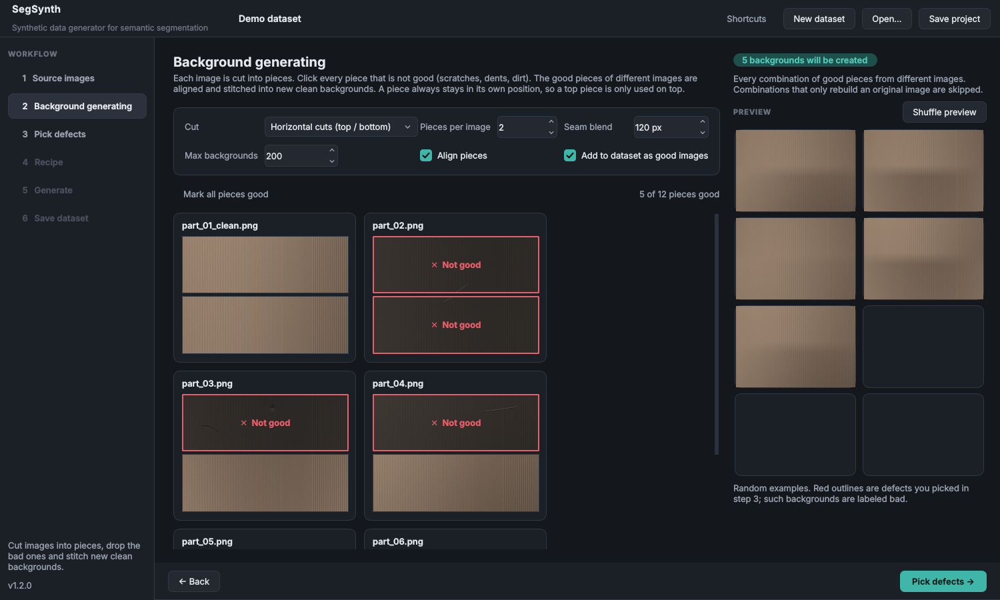

# SegSynth

**Synthetic data generator for semantic segmentation.**

SegSynth grows a small segmentation dataset by copying real defects (scratches, dents, chips, stains…) from a few annotated images, varying their size, shape, curvature and contrast, and pasting them at new positions onto clean or defective backgrounds. It is a classic, fully controllable copy‑paste augmentation tool — no generative AI, no training, deterministic with a seed.


## Why

When only a handful of defect images exist, a segmentation model sees each defect in exactly one place, at one size, on one background. SegSynth multiplies that variety while keeping every synthetic defect made of *real* defect pixels.

- **Texture-preserving pasting.** Before a defect is copied, the local surface behind it is estimated (directional or isotropic) and removed. Only the defect itself is added onto the target, so the target's own grooves, machining marks or grain run through the pasted defect without seams.
- **Shape variation along the defect's own axis.** Elongation, bend and rotation are applied relative to the defect's principal axis, so a scratch gets longer or more curved rather than just wider.
- **Placement control.** Anywhere, same column, same row, or near the original spot, with minimum gaps and avoidance of already-marked defects.
- **Multiple blending methods.** Texture-preserving add, Poisson (normal / mixed) and soft paste; mix several to diversify the dataset.
- **Reproducible.** Every run writes a `manifest.json` with the background, source defect, position and the exact parameters of every paste. Same seed + settings = identical dataset.
- **Label tool export.** Optionally writes a label tool database (`.sqlite`) with every image as a TRAIN sample: background good, defects labeled.
- **Works offline.** NumPy + OpenCV + Qt. 8/16-bit, grayscale or color, PNG/TIFF/BMP/JPEG.

## Workflow

| Step | |
|---|---|
| **1 · Source images** | Add your real images. Tick which ones may receive synthetic defects (clean *and* defective images both work as backgrounds). |
| **2 · Background generating** *(optional)* | Tick **Create background images** in step 1. Each image is cut into pieces; click every piece that is not good. Good pieces from different images are aligned and stitched into new clean backgrounds. |
| **3 · Pick defects** | Brush, box or lasso each defect you want to reproduce. **Snap to defect** shrinks a rough selection to the pixels that stand out from the surface. Only the defects you pick are used — harmless marks can be left alone. |
| **4 · Recipe** | Set how many images to create per defect and how much each copy may vary. **Shuffle preview** shows live variations with the current settings. |
| **5 · Generate** | Runs in the background with progress and a live gallery. Double-click a result to inspect it at full resolution. |
| **6 · Save dataset** | Copy the result to its destination folder (optionally zipped). |

Projects (images, picked defects, recipe, settings) are saved as a folder with `project.json` and can be reopened or run headless later.

<p>
  
  
</p>

## Background generation



Few clean images means few backgrounds. With **Create background images**, every source image is cut into pieces (for example top and bottom halves), you reject the pieces with defects, and SegSynth stitches the remaining pieces from *different* images together:

- **Pieces stay in place.** A top piece is only used on top, because lighting and part geometry depend on position. With 2 pieces the number of backgrounds is *good tops × good bottoms*, minus the combinations that would just rebuild an original image.
- **No visible seams.** Each image is shifted to line up with the first one, then neighbouring pieces are cross-faded over the *Seam blend* band. Cut across the texture (horizontal cuts for grooves running top to bottom) for the most natural result.
- **Labels stay correct.** Generated backgrounds are added to the dataset as good images. If you picked a defect on a source image and keep its piece, the defect follows the piece and the background is labeled bad.
- **Max backgrounds** caps the count; above it a random, reproducible selection is used.

## Install

Requires 64-bit Python 3.10–3.13.

**Windows:** download or clone the repository and double-click **`start.bat`**. The first start creates a private `.venv` and installs everything with pip; later starts open the app directly. `start.bat debug` keeps a console open to show errors.

Other systems:

```bash
python -m venv .venv && source .venv/bin/activate
pip install -e .
python -m segsynth
```

Try it with demo data: `python examples/make_demo_images.py demo_images`

### Offline / air-gapped PCs

The Windows offline bundle is self-contained: it includes its own Python 3.12 with every package installed, so the target PC needs nothing installed.

1. On a PC with internet access, double-click **`make_offline_bundle.bat`** (or run `python packaging/build_offline_bundle.py --platform win_amd64`). It creates `release/SegSynth-<version>-offline-win_amd64.zip` (about 145 MB). It downloads a standalone Python build from GitHub; if GitHub is blocked, download that archive another way and pass it with `--python-dist path\to\archive.tar.gz`.
2. Copy the zip to the offline PC (USB, network share, Ethernet) and unzip it.
3. Double-click **`start.bat`** in the unzipped folder. `start.bat debug` keeps a console open to show errors.

To update, delete the old folder and unzip the new bundle. Works on 64-bit Windows 10 (1809 / LTSC 2019 and newer) and Windows 11. The bundled package versions are pinned in `packaging/windows-bundle-constraints.txt`.

## Headless use

```bash
segsynth generate path/to/project/project.json output_folder [--seed 123] [--masks]
```

## Output

Without a database:

```
my_dataset/
├── synthetic/        synth_00001.png …   generated defect images
├── background/       bg_*.png            generated backgrounds
└── manifest.json
```

With **Generate a .sqlite file** (Save dataset page) the dataset is saved as a workspace the AI tool trains from directly:

```
my_dataset/
├── DATA/
│   ├── synthetic/    synth_*.png
│   └── background/   bg_*.png
├── DATA_THUMB/
├── META/
│   └── my_dataset.sqlite      ← select this file in the AI tool
└── manifest.json
```

- Sample paths in the database are relative to `DATA` (for example `synthetic\synth_00001.png`), which is how the tool resolves them from `META`.
- Background areas are labeled good; pasted defects and defects you picked carry your defect class. Images without defects are good (anomaly "Normal"), images with defects are not good ("Anomalous").
- Images are split into TRAIN and VALIDATE (15 % by default), balanced over good and not good.
- Masks use the tool's run-length format with CRC32; the schema matches settings version 14.

Your real source images are never copied into the dataset: they may contain defects nobody labeled, and a model would learn those as background. Synthetic images pasted onto a real image still contain that image, so when you use real images as backgrounds, pick every real defect on them in step 3 (or use only generated backgrounds). Optional `masks/` and `overlays/` folders are placed next to `DATA`.

To repair a workspace saved with an older version (which included `real_*` images), run:

```bash
python -m segsynth prune "path\to\workspace\META\name.sqlite"
```

It removes the real images and every sample whose image file is missing, from both the database and `DATA`. Deleting image files by hand is not enough, because the database still lists them.

## Settings reference

| Setting | Meaning |
|---|---|
| Size | Uniform scale range of the defect. |
| Elongation | Stretch along the defect's long axis (>1 longer). |
| Rotation | Extra rotation in degrees. Keep small for shading/photometric images — light direction is baked in. |
| Bend | Curvature change along the long axis; sign sets direction. |
| Wobble | Amplitude of a smooth random elastic distortion. |
| Contrast | Strength of the defect relative to the original. |
| Flips | Off by default; flipping reverses light and shadow sides. |
| Surface texture | Direction of the background estimate: vertical, horizontal, isotropic, or off (raw pixels). |
| Texture window | Length of the background window; should be larger than the defect. |
| Edge softness | Feathering of the paste boundary. |
| Defects per image | 1 = only the recipe defect; higher adds random extra defects. |
| Generate a .sqlite file | On the Save page: writes `<dataset>.sqlite`; set the defect class name and colour there. |

## Development

```bash
pip install -e ".[dev]"
QT_QPA_PLATFORM=offscreen pytest
```

Branches: `main` (releases), `develop` (integration), `feature/*` (work). CI runs the tests on Linux and Windows; pushing a `v*` tag builds the release assets.

Project layout:

```
segsynth/core/   engine: background estimation, patches, transforms, placement, blending, generator, project I/O
segsynth/ui/     Qt interface: canvas, pages for each workflow step, theme
packaging/       offline bundle builder and PyInstaller spec
tests/           unit, end-to-end and offscreen UI tests
```

## Notes on synthetic data

Synthetic samples complement real data; they do not replace it. Keep a real-only validation set, check generated images for implausible results, and prefer modest variation ranges first.

## License

MIT
