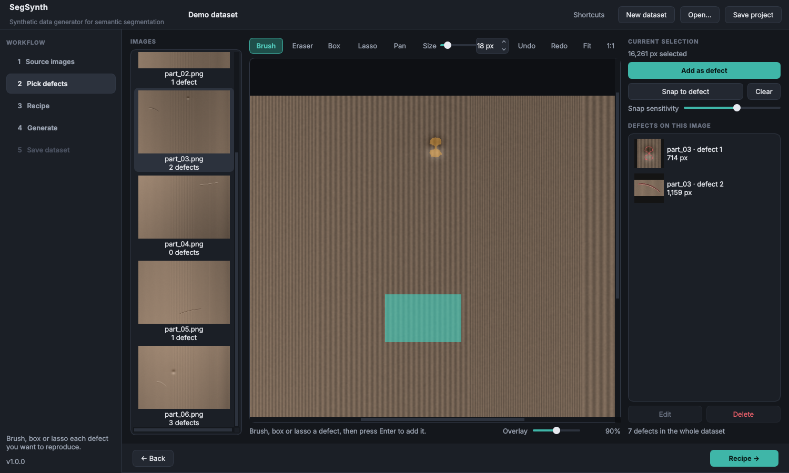
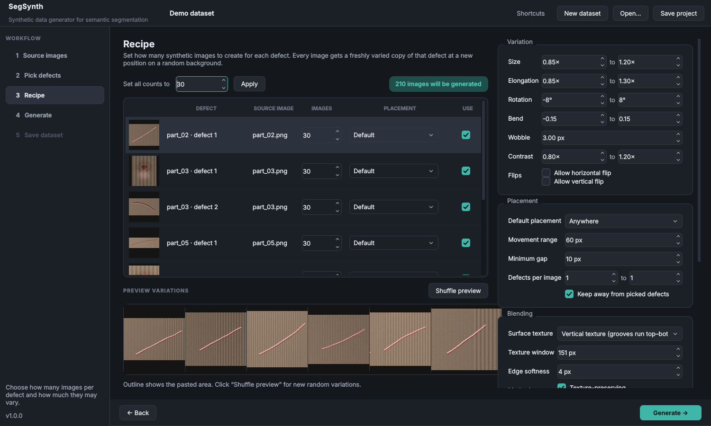
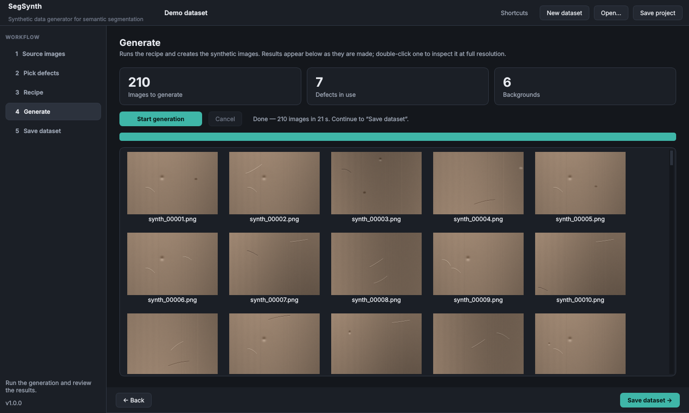

# SegSynth

**Synthetic data generator for semantic segmentation.**

SegSynth grows a small segmentation dataset by copying real defects (scratches, dents, chips, stains…) from a few annotated images, varying their size, shape, curvature and contrast, and pasting them at new positions onto clean or defective backgrounds. It is a classic, fully controllable copy‑paste augmentation tool — no generative AI, no training, deterministic with a seed.



## Why

When only a handful of defect images exist, a segmentation model sees each defect in exactly one place, at one size, on one background. SegSynth multiplies that variety while keeping every synthetic defect made of *real* defect pixels.

- **Texture-preserving pasting.** Before a defect is copied, the local surface behind it is estimated (directional or isotropic) and removed. Only the defect itself is added onto the target, so the target's own grooves, machining marks or grain run through the pasted defect without seams.
- **Shape variation along the defect's own axis.** Elongation, bend and rotation are applied relative to the defect's principal axis, so a scratch gets longer or more curved rather than just wider.
- **Placement control.** Anywhere, same column, same row, or near the original spot, with minimum gaps and avoidance of already-marked defects.
- **Multiple blending methods.** Texture-preserving add, Poisson (normal / mixed) and soft paste; mix several to diversify the dataset.
- **Reproducible.** Every run writes a `manifest.json` with the background, source defect, position and the exact parameters of every paste. Same seed + settings = identical dataset.
- **Label tool export.** Optionally writes a label tool database (`.sqlite`) with every synthetic image as a TRAIN sample and its pasted defects as the segmentation label.
- **Works offline.** NumPy + OpenCV + Qt. 8/16-bit, grayscale or color, PNG/TIFF/BMP/JPEG.

## Workflow

| Step | |
|---|---|
| **1 · Source images** | Add your real images. Tick which ones may receive synthetic defects (clean *and* defective images both work as backgrounds). |
| **2 · Pick defects** | Brush, box or lasso each defect you want to reproduce. **Snap to defect** shrinks a rough selection to the pixels that stand out from the surface. Only the defects you pick are used — harmless marks can be left alone. |
| **3 · Recipe** | Set how many images to create per defect and how much each copy may vary. **Shuffle preview** shows live variations with the current settings. |
| **4 · Generate** | Runs in the background with progress and a live gallery. Double-click a result to inspect it at full resolution. |
| **5 · Save dataset** | Copy the result to its destination folder (optionally zipped). |

Projects (images, picked defects, recipe, settings) are saved as a folder with `project.json` and can be reopened or run headless later.

<p>
  
  
</p>

## Install

Requires Python 3.10–3.13.

```bash
git clone https://github.com/<your-account>/segsynth.git
cd segsynth
python -m venv .venv
# Windows: .venv\Scripts\activate    Linux/macOS: source .venv/bin/activate
pip install -e .
segsynth            # or: python -m segsynth
```

Try it with demo data:

```bash
python examples/make_demo_images.py demo_images
```

### Offline / air-gapped PCs

Two options, both built automatically for every tagged release (see *Releases*):

- **Standalone Windows build** (`SegSynth-x.y.z-windows-standalone.zip`) — unzip and run `SegSynth.exe`. No Python needed.
- **Offline wheel bundle** (`SegSynth-x.y.z-offline-win_amd64.zip`) — for PCs with Python 3.10–3.13. Unzip, run `install.bat`, then `run.bat`. Nothing is downloaded during install.

To build the offline bundle yourself on a machine with internet:

```bash
python packaging/build_offline_bundle.py --platform win_amd64
```

## Headless use

```bash
segsynth generate path/to/project/project.json output_folder [--seed 123] [--masks]
```

## Output

```
my_dataset/
├── images/      synth_00001.png …
├── masks/       (optional) 255 = pasted defect
├── overlays/    (optional) review images with the pasted area outlined
└── manifest.json
```

With **Also create label tool database** enabled, the layout matches what the label tool expects:

```
my_dataset/
├── Images/              synth_00001.png …
├── my_dataset.sqlite    one TRAIN sample per image, pasted defects labeled with your class name
└── manifest.json
```

Open the `.sqlite` in the label tool and the images appear already annotated. The masks are stored in the tool's own run-length format (with CRC32), the schema matches settings version 14, and classification/anomaly annotations get the tool's defaults.

Masks cover only the *pasted* defects. Defects that were already present in a defective background image are not in the mask, so label the final dataset yourself or merge with your existing annotations.

## Settings reference

| Setting | Meaning |
|---|---|
| Size | Uniform scale range of the defect. |
| Elongation | Stretch along the defect's long axis (>1 longer). |
| Rotation | Extra rotation in degrees. Keep small for shading/photometric images — light direction is baked in. |
| Bend | Curvature change along the long axis; sign sets direction. |
| Wobble | Amplitude of a smooth random elastic distortion. |
| Contrast | Strength of the defect relative to the original. |
| Flips | Off by default; flipping reverses light and shadow sides. |
| Surface texture | Direction of the background estimate: vertical, horizontal, isotropic, or off (raw pixels). |
| Texture window | Length of the background window; should be larger than the defect. |
| Edge softness | Feathering of the paste boundary. |
| Defects per image | 1 = only the recipe defect; higher adds random extra defects. |
| Label tool database | Writes `<dataset>.sqlite` plus an `Images` folder; set the defect class name and colour. |

## Development

```bash
pip install -e ".[dev]"
QT_QPA_PLATFORM=offscreen pytest
```

Branches: `main` (releases), `develop` (integration), `feature/*` (work). CI runs the tests on Linux and Windows; pushing a `v*` tag builds the release assets.

Project layout:

```
segsynth/core/   engine: background estimation, patches, transforms, placement, blending, generator, project I/O
segsynth/ui/     Qt interface: canvas, pages for each workflow step, theme
packaging/       offline bundle builder and PyInstaller spec
tests/           unit, end-to-end and offscreen UI tests
```

## Notes on synthetic data

Synthetic samples complement real data; they do not replace it. Keep a real-only validation set, check generated images for implausible results, and prefer modest variation ranges first.

## License

MIT
